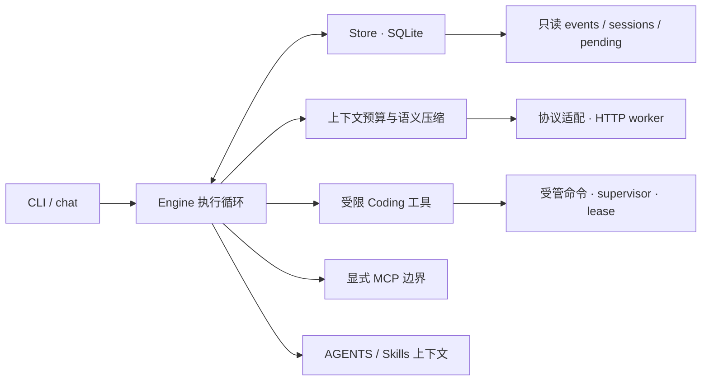

# Agent Resilience Lab

**用 Python 从零实现的一个 Coding Agent Harness：持久 Turn、受监督工具执行、可追溯的上下文续航。**

这不是"套一层模型 API 的脚本"。它是一个把**模型决策**、**工具副作用**、**持久状态**和**上下文预算**绑在同一条可审计链路上的运行时：每一次采样、每一次工具执行、每一次上下文压缩，都能在事后被定位、被复现、被判定"到底发生了什么"。

项目刻意不引入框架。Python 标准库 + SQLite + POSIX 设施，运行时第三方依赖为零。

---

## 为什么做这件事

读 Codex、OpenHands、LangGraph 这些方案时，我发现讨论度最高的是"能不能把任务做完"，而三个真正决定 Agent 可用性的工程问题被反复绕开：

1. **崩溃之后怎么办。** 文件已经改了，checkpoint 还没写，进程被 `SIGKILL`。下一次启动是重放、是跳过，还是承认自己不知道？大多数实现选择"重试"，然后在 `append` 上写出重复内容。
2. **上下文装不下之后怎么办。** 粗暴截断会切碎 assistant/tool 的配对，模型拿到一段自相矛盾的历史，然后开始"幻觉自己做过的事"。
3. **权限从哪来。** 模型输出、项目规则文件、MCP 返回的文本、Skill 里的脚本，都不该等于宿主权限。这个边界一旦含糊，所谓"沙箱"就只是文案。

我把这三件事当成必须给出可验收答案的目标，而不是 README 里的形容词。所以这个仓库里每一条设计都配了三样东西：一个能复现的失败用例、一条可观测的执行轨迹、一句明确的**"它不能证明什么"**。

---

## 核心设计

**1. 显式状态机，而不是框架节点拼装**

`Engine.run` 持有 `ready / model_pending / tool_queued / tool_pending / awaiting_approval` 等阶段，每个阶段的分支都可读、可断点、可回放。模型一次响应里最多 8 个工具调用，按原序**串行**执行——没有并行调度器，也没有隐式的重试层。

> 取舍：Engine 职责集中，没有并行调度与依赖图。换来的是"每一步都能解释"。
> [`engine.py`](agent_lab/engine.py)

**2. 意图先落盘，效果后对账**

工具执行前先把 `planned → running` 持久化，文件工具冻结 before/desired 的内容 SHA 与 mode。恢复时先对账目标当前状态：确认已发生就补记录，确认未发生才允许重试。命令、`append`、MCP 调用这类**没有可靠回执**的效果，一律进入 `needs_confirmation` 并停下。

> 取舍：可安全恢复的范围被主动收窄。checkpoint 从不被当作 exactly-once 的证明。
> [`tools.py`](agent_lab/tools.py) · [`store.py`](agent_lab/store.py)

**3. 上下文续航：最大完整可容纳前缀 + 源游标 + 原归档回查**

达到阈值或即将切碎整组历史时，`compaction.prepare` 选出**能完整放下的最大前缀**做语义摘要，保留上一代笔记、原消息索引与 hash，安装严格推进的中间笔记。工作窗口字节、摘要输入字节、模型输出 token 是三个独立上限。原始归档永不丢弃，模型可以用 `history_lookup` 回查被折叠的原文。

> 取舍：摘要必然会漏信息。它换来的是"长任务不中断"，不是"无损记忆"。
> [`compaction.py`](agent_lab/compaction.py) · [`context.py`](agent_lab/context.py)

**4. 分层授权：模型输出是输入，不是权限**

- 项目规则（`AGENTS.md`）、Skill 正文、笔记：只是上下文，不授予任何权限。
- 工具调用：`prepare` 校验参数、路径、版本与权限后生成冻结的 intent，高风险动作需要**精确到 argv/cwd/可执行身份**的审批。
- 命令执行：默认 NoFork，受管 supervisor + lease/generation 防止旧 worker 晚到写入。
- MCP：显式配置的**受信外部边界**，逐次审批，身份变化即拒绝续跑——它不在命令沙箱里，这一点在文档里从不含糊。

> [`permissions.py`](agent_lab/permissions.py) · [`process_guard.py`](agent_lab/process_guard.py) · [`registry.py`](agent_lab/registry.py)

**5. 证据分层验收**

离线契约测试、真实工具互操作、真实模型任务、冻结质量验收，是四个不同层级，分开记录、分开引用。失败过一次的题不会因为后来修好了就从报告里消失。

> [`docs/EVALUATION.md`](docs/EVALUATION.md)

---

## 架构



模块边界、生命周期状态图、请求与工具结果的时序，见 [`docs/ARCHITECTURE.md`](docs/ARCHITECTURE.md)；十二个关键取舍的问题/替代方案/证据，见 [`docs/DESIGN_DECISIONS.md`](docs/DESIGN_DECISIONS.md)。

---

## 快速开始

需要 Python ≥ 3.9 与 POSIX 环境（原生受管执行以 macOS 为准；Windows 缺少 `fcntl` 等接口，不支持）。

```sh
python3 -m venv .venv
.venv/bin/python -m pip install .
.venv/bin/python -I -m agent_lab --help
.venv/bin/python -I -m agent_lab providers
.venv/bin/python scripts/demo.py
```

`scripts/demo.py` 用显式标注的 `ScriptedModel` 跑通工具与恢复协议，**不产生费用、也不代表自主能力**。真实运行需要自己准备模型 Key 与一个位于仓库之外的费用账本，参数见 [`docs/PROVIDERS.md`](docs/PROVIDERS.md)。

```sh
read -r -s DEEPSEEK_API_KEY; export DEEPSEEK_API_KEY
.venv/bin/python -I -m agent_lab --db .lab/coding.sqlite run \
  '查看项目，修复实现，保持原测试不变，运行测试并根据实际反馈继续。' \
  --workspace /absolute/path/to/your-project --profile coding \
  --model deepseek-flash --base-url https://api.deepseek.com \
  --api-key-env DEEPSEEK_API_KEY \
  --budget-ledger .lab/my-budget.sqlite --allow-api --events
unset DEEPSEEK_API_KEY
```

运行时必须装在**被操作工作区之外**，用 `-I -m agent_lab` 或 console 入口启动，否则目标目录里的同名包会劫持导入。

---

## 评测结果

冻结验收是两个全新领域（报表调度、订阅请求）各四轮连续开发：每轮都要通过原测试、新增测试、累计外部行为检查和不可变文件字节校验。

| 指标 | 实际数字 | 它不能说明 |
|---|---|---|
| 冻结验收 | 2 项目 × 4 轮全通过；72 个最终外部观察、180 个累计观察 | 通用任务成功率；两项任务是同环境角色分离的有限合成场景 |
| 语义摘要 | 23 代自动摘要，跨轮实现修改请求与对应笔记逐条绑定 | 无损记忆；每个 AST 节点都被覆盖 |
| 模型请求 | 172 次请求，3,393,135 输入 / 205,704 输出 token，0 unknown | 供应商账单；估算峰时费用 ¥8.431902 只是估算 |
| 崩溃恢复 | 摘要已提交的 ready 边界实际 `SIGKILL`，PID 87643 → 87652，同归档同笔记续跑后改码通过 | 任意时刻被杀都安全；外部 exactly-once |
| 全仓回归 | 1139 项、0 skip、877.967 秒、exit 0 | 1139 个真实 Agent 任务，或生产成熟度 |
| 保留的失败 | 早期 context v1 = 1/2，v2/v3/v4 = 0/2，原报告与候选 diff 一字未改 | — |

完整口径（含每个数字的证据路径与"为什么不能这样用"）在 [`docs/EVALUATION.md`](docs/EVALUATION.md)。

---

## 目录结构

```
agent_lab/        运行时：Engine、Store、上下文、工具、沙箱、MCP、协议适配
tests/            契约测试、故障注入、真实进程与存储失败用例
evaluation/       冻结任务、冻结清单、验收运行器与原始结果
acceptance_suite/ 合成工作区与不可变验收套件
evidence/         原始报告、trace 投影、回归日志（机器产物，不修饰）
scripts/          演示、上下文续航验收、打包
docs/             架构、设计决策、评测、安全、协议、路线图
docs/notes/       对上游参考实现的源码级研究笔记（23 篇）
```

---

## 已知限制

这是单机实验性工程，不是生产平台。明确没做到的：

- 只验证了 macOS 上的原生沙箱；Linux 与 Windows 没有等价 backend，不可用时**拒绝执行**而非裸跑。
- 支持 stdlib Python 与显式注册的宿主解释器，普通 `npm` / `make` / PTY 生态未覆盖。
- 摘要不是无损记忆，checkpoint 不承诺外部 exactly-once，未知效果一律暂停。
- 没有并行工具调度、完整 TUI、多模态与分布式会话。
- 未做源码相似度专项审计，第三方研究材料按各自原许可保留（见 [`THIRD_PARTY_NOTICES.md`](THIRD_PARTY_NOTICES.md)）。

---

## 设计参考

实现前逐函数读过固定版本的开源 Codex CLI（`e6bf88ae022cdab968e5a48d5cbeea4d2e304fc9`），把"上游为什么这么写"和"我这里的取舍"分开记在 [`docs/notes/`](docs/notes/) 的 23 篇笔记里——包括搜索分页、流式工具取消、会话分叉、进程组排空、终端历史、macOS fork 控制等。参照不是复刻：没有用相同任务跑过原版对照，所以本文不给"行为一致率"这类数字。

## 作者与实现说明

设计、协议定义、取舍判断与验收标准由作者完成；实现过程中使用 AI 编码助手辅助生成部分代码与测试，所有提交经作者审查。架构与执行语义的解释责任在作者。

## 许可

自有代码与文档采用 [Apache-2.0](LICENSE)；第三方研究材料保留原许可，见 [NOTICE](NOTICE) 与 [THIRD_PARTY_NOTICES](THIRD_PARTY_NOTICES.md)。
