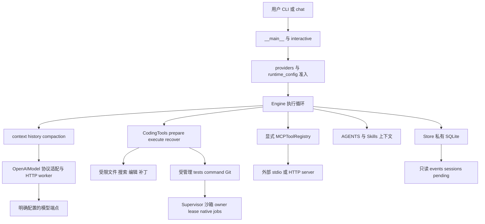
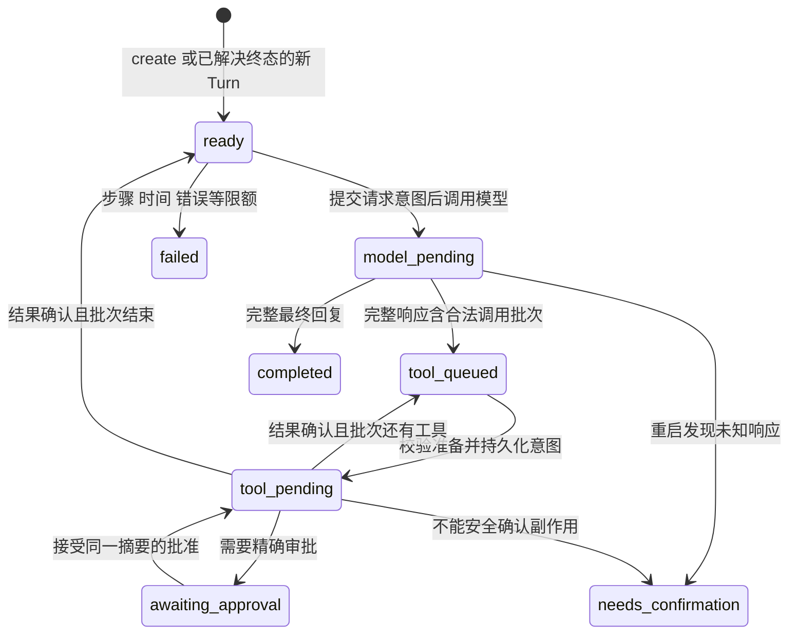
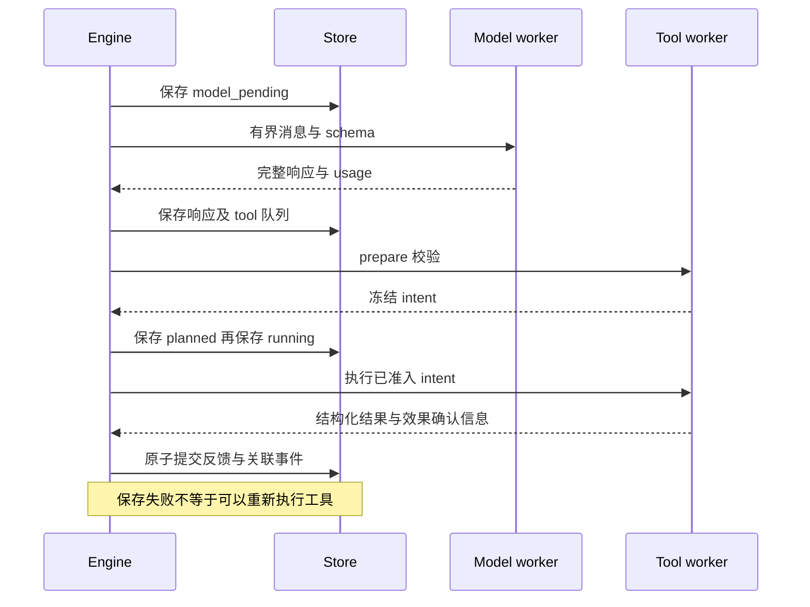
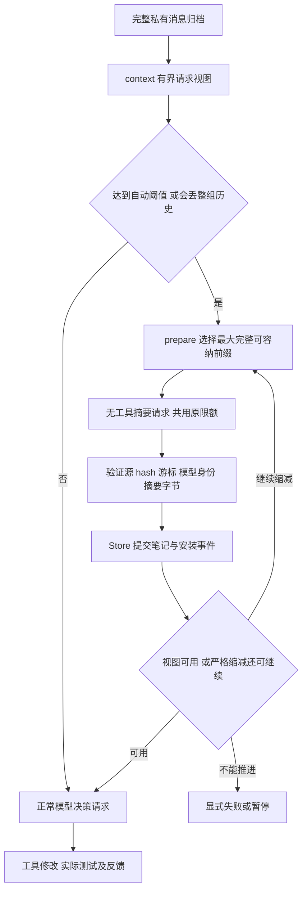

# 系统架构

Python 标准库实现，CLI 是主入口。没有 Web 后端、独立消息队列、分布式调度或向量数据库。外部 MCP 是显式受信扩展，不画进命令沙箱里。

## 模块边界

入口：[`__main__.main`](../agent_lab/__main__.py)、[`Engine`](../agent_lab/engine.py)、[`Store`](../agent_lab/store.py)、[`CodingTools`](../agent_lab/coding_tools.py)、[`MCPToolRegistry`](../agent_lab/registry.py)。模型客户端不负责批准命令；文档与模型输出不拥有宿主权限。

## 生命周期与状态

图省略了各阶段的停止、拒绝与配置错误分支，节点之间也不是任意可达。`Engine.run` 先校验已保存的 pending/queue/调用配对与运行配置，持锁后分派 `_request`、`_prepare_next_tool`、`_tool`。恢复一个已开始的工具时，**先对账再检查时间限额**，避免"超时"掩盖未知效果。

`completed` 只表示模型这一轮说完了，不自带任务正确性保证——通用运行里的 `verified_success` 通常仍是 null。只有外部验收器才用原测试、全测试、独立观察与约束评分判定任务成功。审批等待、失败、未知与成功，四个状态不混用。

## 模型请求与工具结果

1. `_request` 在已解决的 ready 边界处理持久输入/停止、必要上下文与自动摘要，然后提交 `model_pending` 与尝试计数。
2. `OpenAIModel.complete` 把统一消息与工具 schema 翻译成 Chat / Responses / Anthropic 请求。凭据只给明确端点的 HTTP worker；项目工具进程使用干净环境。
3. SSE 文本可以增量显示，但**参数与响应未完整结束时不进入工具执行**。三种协议各自检查终止标记与完成项，不能只看 HTTP 200 或半段 JSON。
4. `_response` 保留完整 assistant 消息，校验唯一 call ID 与批次；最多 8 个调用按原序**串行**执行。
5. `prepare` 校验参数、路径、版本与权限并生成冻结的 intent；`_tool` 先把 running 持久化，再执行或恢复。
6. `_feedback` 在候选 state 中追加结构化结果并原子保存，之后才允许下一个工具或下一次采样。普通测试非零退出是可修正反馈；坏参数计入错误；受信可选 Git 不可用时保留失败反馈，但不浪费无效调用预算。

## Task、Session、Turn

`Task` 是 SQLite 行与状态 JSON；`session_id` 是其中的逻辑会话身份，`turn_id` 标识一轮用户需求，`turns` 保存各轮快照。没有另建 Session 服务。

- `continue_turn`：上一轮已解决、无 pending/queue/未决输入时，保留 Session 与文件，追加自然用户任务并创建新 Turn。
- `resume`：读同一 Turn，不追加新任务。
- `fork_session`：只允许已解决历史，生成新身份与 lineage，**共享工作区文件**，不是自动创建 Git worktree。
- `steer`：写独立 SQLite inbox，在完整工具批次之后的采样边界事务应用，final 提交再重查 inbox，避免吞输入。queued 证明入队，applied 证明进入历史，都不证明模型遵从。
- `stop`：同样是独立持久记录与 claim gate。模型/native/MCP 等待的取消机制分层，只把 phase 写成 failed 不代表子进程已终止。

CLI 的 `sessions` / `events` / `pending` 是只读观察，不验证进程 liveness，也不自动恢复。

## 上下文、自动摘要与续跑

`compaction.prepare` 不切开 assistant/tool 配对；旧笔记计入新摘要成本；最新当前批次保留。只有下一条自然用户输入才能释放上一轮末批次，运行时通知不能伪造用户边界。大结果给带 SHA/索引的预览，原文仍可 `history_lookup` 回查。工作字节窗口、摘要输入字节与模型输出 token 上限是三个不同限制。

安装记录包含源投影 SHA、覆盖游标、generation、summary SHA 与模型身份。摘要以用户级、不可信笔记的身份进入请求，不授予权限；原归档不被笔记替代。中间笔记必须严格推进，次数、请求与 deadline 沿用原 Turn，不能无限压缩。

真实运行中的证据：两个项目最终分别是 12 / 11 代笔记，四轮之后仍通过累计功能检查；第一个项目最终笔记游标 168，而最后一次实现修改请求（call 33）实际用的是游标 156。**实际请求**、安装事件、修改操作与外部执行到的模块必须绑定——不能拿最终 state 里的新笔记给早先的请求补证据。哈希只证明身份，不证明摘要语义无损。

## Checkpoint、执行者与故障

`Store.save` 提交状态候选与元数据事件，事件 ID 用于有限重复保存去重。SQLite 持续写失败时保留原 durable 意图并给固定诊断，不因为内存里已有返回值就假装已持久成功。

文件写入冻结 before/desired 内容与普通 mode，以临时文件 + rename 实现有限原子替换；恢复时核对目标当前版本与预期，确认已发生或安全重试。外部 append、命令、MCP 可能已有副作用但没有可靠确认，必须 `needs_confirmation`——不能靠 checkpoint 推导出 exactly-once。

`process_guard` 用 generation 与执行 lease 阻止旧 worker 晚到与错误接管；native supervisor 拥有项目进程，owner pipe 处理 Runner 死亡与取消。`native_jobs` 先登记、再发布保护索引、最后启动，只有可信 producer 确认 join 后才写 quiescent，未知时隔离工作区而不是自动解除。实验性的 confined-fork 另有 owned-group/collector；默认 NoFork 不变。

实战验证：在**摘要已提交、没有工具正在执行**的 ready 边界实际 `SIGKILL` Runner，新 PID 打开同一 DB 后归档与笔记一致、无旧 opID 再启动，后续改码通过。这不构成对任意杀死时刻、恶意进程树或外部系统的保证。

## MCP 与 Skills

- `MCPToolRegistry` 在宿主显式配置之外不自动发现 server。进入 registry 时握手与分页发现，合成工具 schema 与身份 manifest；每次外部调用精确审批，身份变化即拒绝续跑。
- `mcp.py` / `mcp_http.py` 分别实现 stdio 与有限的 Streamable HTTP。资源按 server 暴露 list/templates/read，二进制只给校验后的类型、长度与 hash。未知效果不重放，取消等待不等于远端静止。MCP 配置与进程位于受信外部边界，不在 native 沙箱内；read-only 保护模式不能简单沿用外部 MCP。
- `instructions.py` 发现项目 AGENTS 与 Skills，`skill_resources.py` 读取有界资源、捕获 Python 脚本源码快照，再复用命令审批与沙箱。加载 `SKILL.md` 不等于执行，规则内容不等于系统授权。没有全局插件商店、OAuth 或共享资源聚合服务。

## Trace 与证据链

`Store.events` 提供 DB 全局 seq 与 task/turn/revision/operation 等白名单元数据。模型请求与响应记录 usage、耗时、有限错误分类、request ID hash；工具记录名称、耗时、重试/恢复/终止与受信结果。原始正文与完整私有历史同默认元数据分离，`--stream-tools` 也是显式私有显示，片段不能决定完成。

状态与事件同事务提交，但这不表示完整 event sourcing，也不证明远端收到了请求。验收 Runner 另外保存请求快照、源游标、实际变更、候选 diff 与外部观察。

详见 [设计决策](DESIGN_DECISIONS.md) 与 [验收与结果](EVALUATION.md)。
